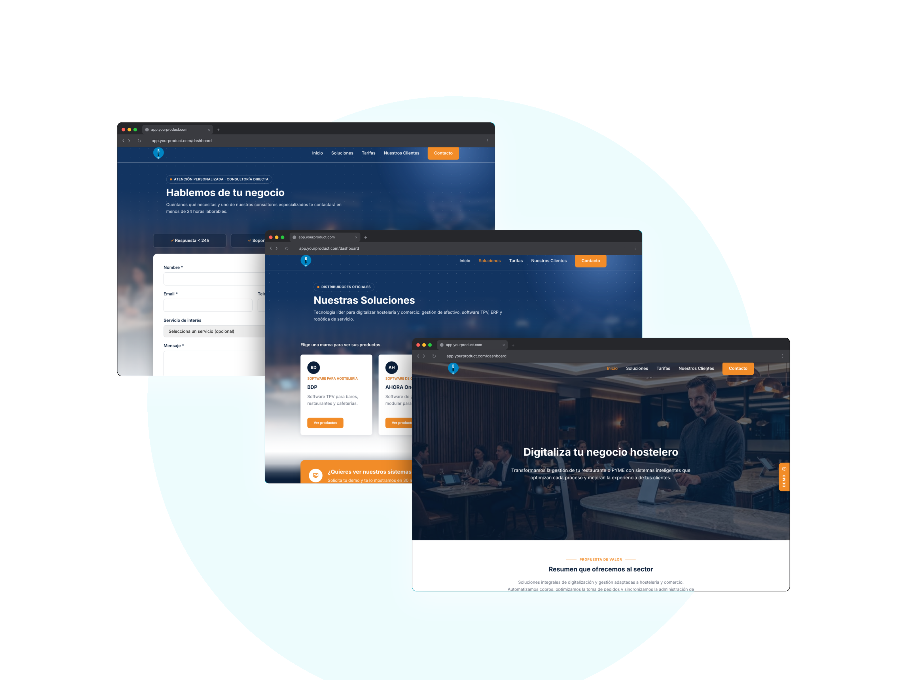
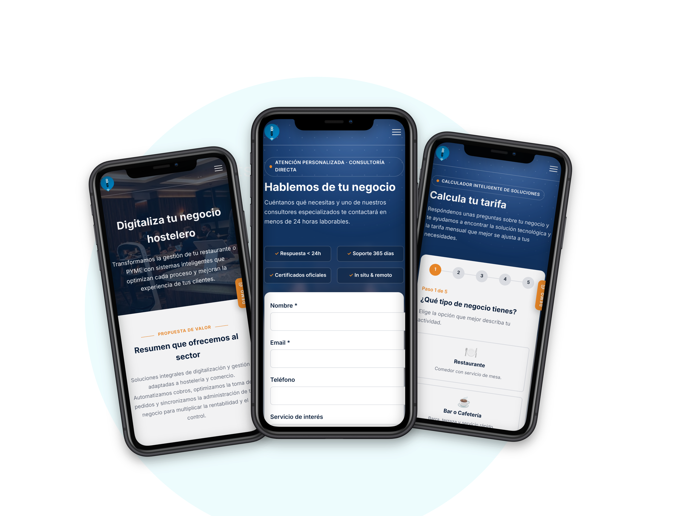

#  BG Sistemas Informáticos

This is my individual final project for the **Factoría F5 Full Stack Development Bootcamp**.

BG Sistemas Informáticos is a company in Ribadeo (Lugo) that sells and installs POS software, cash management systems and service robots for restaurants and shops. The application rebuilds its website: visitors discover the brands and products, calculate an estimated monthly price and ask for a quote without logging in, and the company manages all the content from a private administration panel.

         

# 📑 Index

- [🗂️ Project Structure](#structure)
- [✨ Features](#features)
- [📸 Screenshots](#screenshots)
- [🎨 Prototype](#prototype)
- [📖 Project Documentation](#documentation)
- [👩‍💻 Author](#author)

## 🗂️ Project Structure

The project uses a decoupled architecture, with the frontend and backend maintained in separate repositories. This repository contains the frontend: a responsive single-page application built with Vue 3 and Vite.

-  **[Frontend repository](https://github.com/lcortes89/BG_SistemasInformaticos_Front)**
-  **[Backend repository](https://github.com/lcortes89/BG_SistemasInformaticos_Back)**

[↑ Index](#index) • [Features →](#features)

## ✨ Features

### 🏠 Home & Solutions

- Explore the website without an account.
- See a hero with the photo chosen by the company, the featured products and the sectors it works with.
- Discover the official brands and their products, one page at a time.
- Open the full product sheet, zoom into the image and visit the maker's official page.

### 🧮 Rates Wizard

- Answer step-by-step questions about the business.
- Get an **estimated monthly price**.
- Ask for a proposal directly from the result.
- Read the frequently asked questions.

### ⭐ Clients & Contact

- Read the success stories of the clients.
- Send a contact form with the product of interest and the GDPR consent.
- See the office on the map and contact the company by phone, email or WhatsApp.
- Read the legal notice, privacy policy and cookies policy.

### 📱 Responsive Design

- Works on desktop, tablet and mobile.
- Hamburger menu on mobile and a header that changes when scrolling.
- Skeleton cards while the content is loading.

### 🛠️ Administration Panel

- Private panel at `/admin`, only for administrators.
- Summary with counters and the latest contacts.
- Contacts inbox: search, filter by status, add notes, archive and delete.
- Create, edit, hide and delete brands, products and clients, with search, filters and pagination.
- Manage the questions and prices of the rates wizard.
- Export brands, products and clients to **Excel** or **PDF**.
- Upload images and change the hero photo and the notification email.
- Invite, block, unblock and delete other administrators.

### 🔐 Security & Account

- Log in with email and password, with a button to show or hide the password.
- Turn on **two-step verification (2FA)** by scanning a QR code with an authenticator app.
- Confirm the password again before deleting or making other sensitive changes.
- Reset a forgotten password and change the email with a link sent by email.
- The session closes after some time without activity, with a warning before.
- Logging out in one tab logs out every tab of the browser.

[← Project Structure](#structure) • [↑ Index](#index) • [Screenshots →](#screenshots)

## 📸 Screenshots

### 💻 Desktop

### 📱 Mobile

Every page on desktop and mobile, including the administration panel, is on **[9. 📸Screenshots](https://github.com/lcortes89/BG_SistemasInformaticos_Front/wiki/Screenshots)**. The sketch and the design process are on **[3. 📋Project Management & User Stories](https://github.com/lcortes89/BG_SistemasInformaticos_Front/wiki/Project-Management-&-User-Stories)**.

[← Features](#features) • [↑ Index](#index) • [Project Documentation →](#documentation)

## 📖 Project Documentation

The full project documentation is available in the project Wiki:

### [1. 🏠Home](https://github.com/lcortes89/BG_SistemasInformaticos_Front/wiki)

### [2. 🚀Getting Started](https://github.com/lcortes89/BG_SistemasInformaticos_Front/wiki/Getting-Started)

### [3. 📋Project Management & User Stories](https://github.com/lcortes89/BG_SistemasInformaticos_Front/wiki/Project-Management-&-User-Stories)

### [4. 🗺️Analysis and Diagrams](https://github.com/lcortes89/BG_SistemasInformaticos_Front/wiki/Analysis-and-Diagrams)

### [5. 🏛️Architecture](https://github.com/lcortes89/BG_SistemasInformaticos_Front/wiki/Architecture)

### [6. 🔐Security](https://github.com/lcortes89/BG_SistemasInformaticos_Front/wiki/Security)

### [7. 🔌API Integration](https://github.com/lcortes89/BG_SistemasInformaticos_Front/wiki/API-Integration)

### [8. 🧪Testing](https://github.com/lcortes89/BG_SistemasInformaticos_Front/wiki/Testing)

### [9. 📸Screenshots](https://github.com/lcortes89/BG_SistemasInformaticos_Front/wiki/Screenshots)

[← Screenshots](#screenshots) • [↑ Index](#index) • [Author →](#author)

## 👩‍💻 Author

**[Luisa María Cortés](https://github.com/lcortes89)**

[← Project Documentation](#documentation) • [↑ Index](#index)
